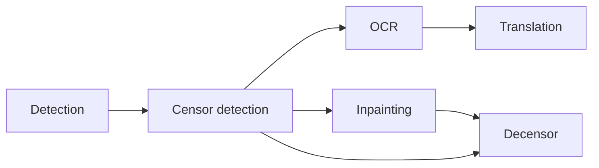

# koharu-pipeline

`koharu-pipeline` coordinates detection, OCR, translation, and inpainting over a
`koharu_scene` project. It owns model lifetime and scheduling; the caller owns
durability through the `Committer` trait.

The execution unit is one stage on one page. A stage result is committed as
soon as it finishes, so the application can refresh that page immediately and
retain completed work if the user stops the run or a later model fails.

## Execution

```rust,ignore
let report = pipeline
    .execute(
        session.snapshot(),
        Request {
            operation: Operation::Full,
            scope: Scope::Project,
            stop: stop.clone(),
            progress: Some(progress),
        },
        &mut committer,
    )
    .await?;

match report.status {
    RunStatus::Completed => println!("all page stages finished"),
    RunStatus::Stopped => println!("completed commits were kept"),
}
```

`Committer::commit` receives a `StageOutput` and returns the committed
`Snapshot`. Pipeline outputs are optimistically rebased onto the latest
snapshot before the callback. Stage patches observe the exact hierarchy,
components, and assets they consume. OCR, translation, and inpainting branches
on one page therefore compose, while a changed input or overlapping write fails
conflict validation instead of publishing stale derived output.

The application records each completed stage as its own named state in the
project history panel, so a pipeline run can be undone stage by stage.

## Configuration

`Pipeline::load` reads `PipelineConfig` itself. The pipeline subscribes to the
shared configuration and publishes a new immutable stage generation through
`ArcSwap` whenever that section changes. An execution keeps the generation it
started with, while later executions see the replacement. Models remain lazy.

The public pipeline constructor accepts provider configuration rather than a
prebuilt translator. Processor construction is a pipeline responsibility;
translation does not require a separate application-owned runtime path.

Translation is a normal pipeline processor. Its model selection, target
language, instructions, and generation options live under
`[pipeline.translation]` and are captured in the same immutable runner
generation as detection, OCR, and inpainting. Provider connection settings are
owned by `koharu-translator` under `[providers]`.

Inpainting selects a fast bubble model under `[pipeline.inpainting] bubbles`
and an independent artwork model under `[pipeline.inpainting.artwork] model`.
Artwork and decensoring own per-model settings under
`[pipeline.inpainting.artwork.<model>]` and `[pipeline.decensor.<model>]`.
The same model never shares prompts, sampling options, or ComfyUI endpoints.
Model switches preserve every saved profile of that route.

Detection commits disjoint `bubble-text-mask` and `artwork-text-mask` assets
plus their `text-mask` union. Inpainting fills uniform bubble interiors
without inference, uses LaMa/AOT for the remaining bubble text, then uses the
artwork model (FLUX.2 Klein 9B by default) for other lettering, including SFX.
Manual masks use the artwork route. Only masked pixels are committed;
previous cleanup outside the mask is preserved. Legacy text-mask-only pages
require whole-page detection again; regional reruns preserve existing route
masks outside their scope rather than silently converting incomplete masks.

The translation processor delegates provider execution and local-model
residency to `koharu_translator::Translator`, but the translator does not load
or watch workflow configuration. Each result replaces the `Translation`
component of a semantic `TextContent` entity; the selected target language is
stored as metadata on that value. The related analysis region and presentation
layer remain independently editable entities.

## Fixed workflow

The workflow is small and explicit:



There is no runtime graph or graph library. `Operation` selects a subset of
this workflow:

- `Full`
- `Through(Stage)`
- `Only(Stage)`

For each page, a stage starts only after its selected prerequisite commits.
In particular, selected censor detection commits before OCR or inpainting
captures the page's asset collection. This prevents a newly written
`censor-mask` from invalidating either reader's stage output. Decensoring also
waits for selected inpainting so it preserves that page's latest cleanup.
Unselected prerequisites do not block an `Only` or custom-stage operation.

Pages enter in project order and the scheduler always selects the oldest ready
page; there is no global wave barrier. On an accelerator, ready jobs share one
execution lane while loaded models remain resident across pages. Benchmarks on
the target CUDA workload showed that overlapping heterogeneous model pairs
increased makespan by 2.5-4x through kernel and memory-bandwidth contention.
Serial model execution therefore produces more pages per second than maximizing
the activity percentage reported by the GPU.

The readiness window still matters: committed prerequisites expose each page's
next jobs without waiting for an unrelated page to finish. CPU-only execution
retains independent per-model lanes because it does not use the accelerator
gate.

Page priority prevents an upstream model from racing arbitrarily far ahead,
while independent page branches use otherwise idle models. The number of
active pages is bounded by the selected stage count, so the scheduler keeps a
small rolling window instead of filling an unbounded upstream queue.

Stages return an empty patch when their page has no applicable input. A page
with no detected text skips OCR and translation work; an empty removal mask
skips inpainting inference. These are normal completed work items, not
preflight failures.

## Stop semantics

`StopToken` is cooperative scheduling control, not transactional cancellation.

- `stop()` prevents new work from starting.
- A native inference already in progress reaches its safe return boundary.
- Its result is discarded if stop was requested before commit.
- Every earlier commit remains in the project.
- `execute` returns `Ok(Report { status: RunStatus::Stopped, .. })`.

Errors are reserved for invalid input/output, model load or inference failure,
and commit failure. An error also leaves earlier page-stage commits intact.

## Model residency

Models are loaded lazily and remain resident for reuse across pages. Normal
execution never unloads a model based on recent usage or sampled memory.
If a stage reports an out-of-memory failure, the accelerator gate unloads the
other stage models, allows the device to settle, and retries that stage once.
The requested model remains loaded when possible.

Inpainting and decensoring reuse one native weight allocation when they select
the same model. Their stage backends retain separate conditioning; weights are
released once no loaded stage holds them.

Empty masks skip model loading. Cleanup preparation borrows already decoded
mask and layer pixels where possible, and masked composition scans the mask's
bounding box rather than every page pixel. Flat-fill and tiled reconstruction
retain the same mask threshold and outside-mask pixels.

The resource monitor samples the selected accelerator ten times per second for
UI telemetry. On Windows, DXGI supplies the process-aware memory budget while
NVML supplies NVIDIA compute utilization. Telemetry does not control model
lifetime.

`ModelCell` serializes access to one model and prevents an active model from
being unloaded.

### Measured cleanup overhead

On Windows with an AMD Ryzen 7 9700X, debug builds, and a real 1280×1807 page,
the best of five host-path runs produced the following totals. Decoded assets
were prepared before timing. Model inference was replaced with identical
deterministic output in both paths and excluded; PNG encoding is included.
Tile calls and output pixels were compared exactly and remained identical.

| Host path | Before | After |
| --- | ---: | ---: |
| Text cleanup preparation, tiling, composition and PNG | 962.6 ms | 458.5 ms |
| Decensor preparation, tiling, composition and PNG | 779.5 ms | 572.2 ms |

These are host-overhead measurements, not full diffusion generation times.

## Stages

`stages/mod.rs` defines `StageProcessor`. Each stage owns the same small
lifecycle contract:

- identify its model;
- load lazily;
- unload during explicit memory-pressure recovery;
- process exactly one page and produce a semantic `Patch`.

`StageInput` carries one page ID plus optional entity and region filters for
that page. A stage cannot receive a project or page collection. Stage
implementations own their preprocessing, inference, and scene mapping. There
is no shared `common.rs`, stage registry indexing, or catch-all processor enum.
`Stages` has named fields and one exhaustive dispatch point.

## Progress

Progress events carry both page and stage:

- `Started { pages, stages }`
- `Loading { page, stage, model }`
- `Running { page, stage, model }`
- `Finished { page, stage, model, elapsed }`
- `Skipped { page, stage }`

`Finished` is emitted after the stage output commits. Progress callbacks are
isolated from panics and cannot crash execution.

## Source map

```text
src/
  accelerator.rs  serialized accelerator execution and OOM recovery
  config.rs       model selection and serialized settings
  error.rs        typed execution failures
  execution.rs    one request's scheduling, commits, progress, and report
  images.rs       decoded scene-asset reuse within each active page
  model_cell.rs   lazy model ownership and per-model serialization
  pipeline.rs     configuration generations and public execution entry point
  progress.rs     request-local progress events
  report.rs       run outcome, stage output, and Committer
  request.rs      operation, scope, and StopToken
  resources.rs    UI-facing accelerator and host-memory telemetry
  scheduler.rs    page window, stage readiness, and lane scheduling
  scope.rs        validated project/page/region/entity scope
  stage.rs        stable stage identifiers
  stage_runner.rs model loading, processing, progress, and retry classification
  stages/         detection, OCR, translation, and inpainting processors
```

## Validation

```powershell
cargo test -p koharu-pipeline --all-targets
cargo clippy -p koharu-pipeline --all-targets --no-deps -- -D warnings
cargo bench --profile dev -p koharu-ml --bench pipeline_overlap
```
