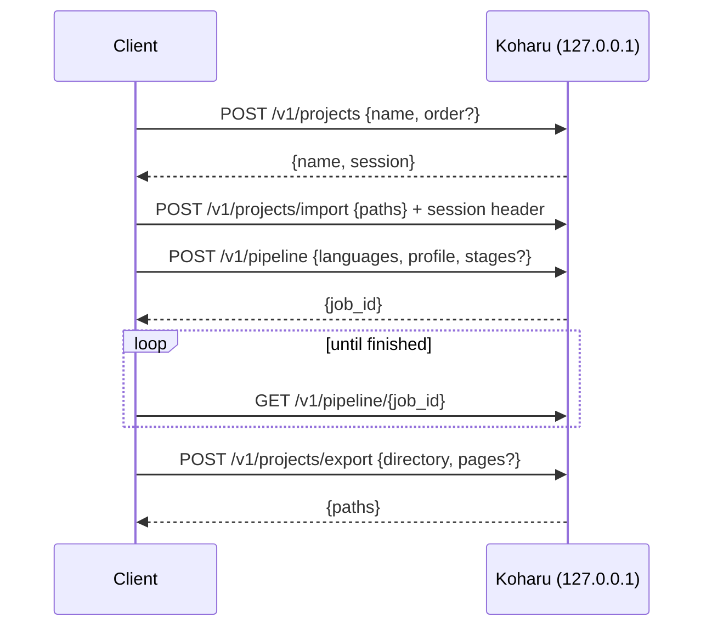

# Automation API

This fork can be driven by another local program: a chat bot, a watch-folder
script or a batch tool. The desktop app then exposes a small HTTP API on the
loopback interface. The API reuses the same project, pipeline and export code
as the window, so everything an automated run produces can be opened and
edited in the editor afterwards.

The API is **off** unless a token is configured. It never listens on a public
interface.

## Enable it

Set these environment variables before starting Koharu:

| Variable | Required | Meaning |
|---|---|---|
| `KOHARU_AUTOMATION_TOKEN` | yes | Bearer token every request must send. Non-empty, single line. |
| `KOHARU_AUTOMATION_ROOT` | yes | Directory the API may read from and export to. Every path in a request must resolve inside it; symlinked paths are rejected. |
| `KOHARU_AUTOMATION_PORT` | no | TCP port on `127.0.0.1`. Default `48765`. |

```powershell
$env:KOHARU_AUTOMATION_TOKEN = "change-me"
$env:KOHARU_AUTOMATION_ROOT  = "D:\koharu-jobs"
& "C:\Program Files\Koharu\koharu.exe"
```

## Request flow



Every request carries `Authorization: Bearer <token>`. Project-bound requests
also carry `X-Koharu-Automation-Session: <session>` from the create call. The
session is pinned to the project that call opened: if someone opens another
project in the window, or the same project is reopened, later calls fail with
`409 Conflict` instead of touching the wrong document.

## Endpoints

| Method and path | Body | Result |
|---|---|---|
| `GET /health` | — | `{status, pipeline_stages}` |
| `POST /v1/projects` | `{"name": "...", "order": {...}?}` | Creates and opens a project; `{name, session}`. Refused with `409` while a pipeline job is running. |
| `POST /v1/projects/import` | `{"paths": ["..."]}` | Imports images or archives in the given order; `{pages}`. |
| `GET /v1/projects/pages` | — | Page list of the pinned project. |
| `POST /v1/pipeline` | `{"source_language": "ja-JP", "target_language": "en-US", "content_profile": "manga", "stages": [...]?}` | Starts a job over the whole project; `{job_id}`. `content_profile` is `manga`, `comic` or `hentai`. Omit `stages` for the full pipeline. |
| `GET /v1/pipeline/{id}` | — | Job: `state`, `completed`/`total`, current `stage` and `model`, `policy_rejected_pages` (one-based pages a provider refused), `error`. |
| `POST /v1/pipeline/{id}/stop` | — | Stops a running job cooperatively. |
| `POST /v1/projects/export` | `{"directory": "...", "pages": [1, 3]?}` | Writes PNG pages into the directory; `{paths}`. Page numbers are one-based; omit `pages` to export all. |

Errors are JSON `{"error": "..."}` with `400`, `401`, `404`, `409` or `422`.

## Linking an orders dashboard entry

`POST /v1/projects` accepts an optional `order` object. When present, the
project is linked to an entry of the [orders dashboard](../workflow/orders.md)
with the same number, created if it does not exist yet:

```json
{
  "name": "order-1042",
  "order": {
    "number": "1042",
    "title": "Chapter 12",
    "client_name": "client",
    "source_language": "ja-JP",
    "target_language": "en-US",
    "assignee": null,
    "brief": "Keep honorifics."
  }
}
```

If the order cannot be stored, the new project is removed again so the two
never disagree.

## Example with curl

```bash
T="Authorization: Bearer change-me"
S=$(curl -s -H "$T" -H 'Content-Type: application/json' \
  -d '{"name":"demo"}' http://127.0.0.1:48765/v1/projects | jq -r .session)
H="X-Koharu-Automation-Session: $S"
curl -s -H "$T" -H "$H" -H 'Content-Type: application/json' \
  -d '{"paths":["D:/koharu-jobs/in/001.webp","D:/koharu-jobs/in/002.webp"]}' \
  http://127.0.0.1:48765/v1/projects/import
JOB=$(curl -s -H "$T" -H "$H" -H 'Content-Type: application/json' \
  -d '{"source_language":"en-US","target_language":"ru-RU","content_profile":"manga"}' \
  http://127.0.0.1:48765/v1/pipeline | jq -r .job_id)
curl -s -H "$T" http://127.0.0.1:48765/v1/pipeline/$JOB
curl -s -H "$T" -H "$H" -H 'Content-Type: application/json' \
  -d '{"directory":"D:/koharu-jobs/out"}' http://127.0.0.1:48765/v1/projects/export
```

## Security notes

- The listener binds `127.0.0.1` only. Do not proxy it to a network.
- The token is compared in constant time; treat it like a password and pass it
  through the environment, not the command line.
- Paths are canonicalized and must stay inside `KOHARU_AUTOMATION_ROOT`.
- The API runs the pipeline with the providers and models configured in the
  app; it does not accept credentials or model settings in requests.
