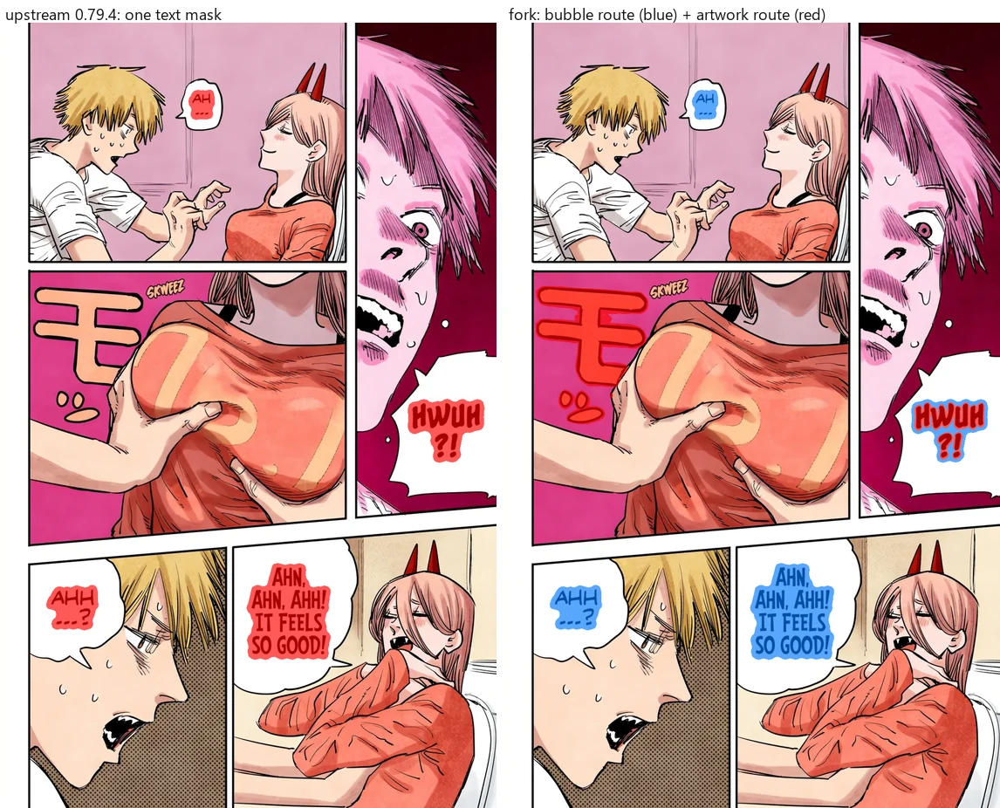
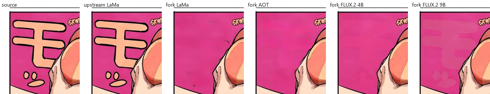
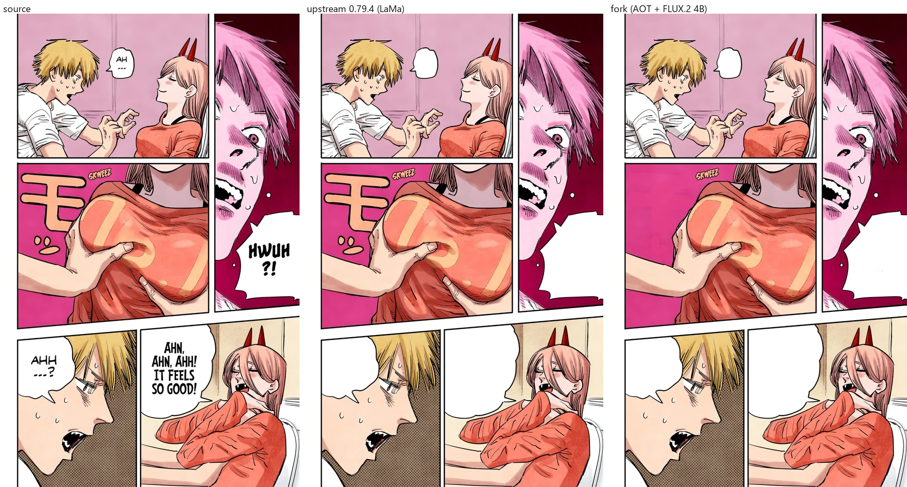
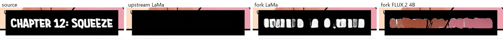
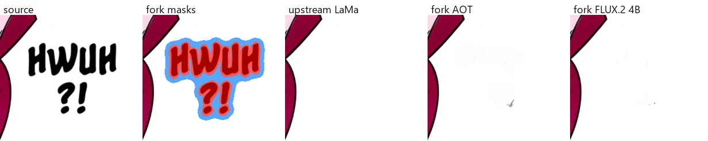
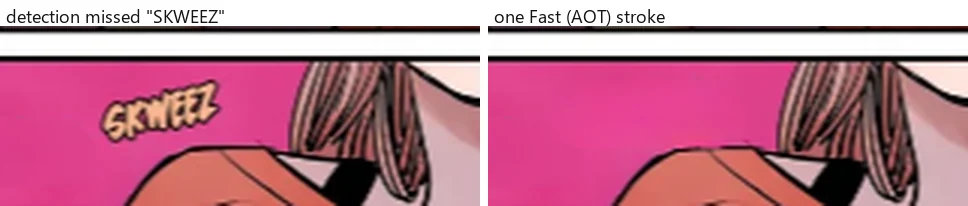

# Cleanup evidence

This page records why the fork removes lettering the way it does, measured
against upstream Koharu **0.79.4**, the release the fork is based on. It lists
where the fork is better, where it is worse, and how to reproduce every number.

## Setup

- Hardware: RTX 5070 Ti 16 GB (PCIe 4.0 x16), Ryzen 7 9700X, 31 GB RAM,
  Windows 11.
- Runtime: stable-diffusion.cpp `master-827-97d2990`, CUDA.
- Pages: two 1080×1706 color manga pages with speech bubbles, a caption box,
  English and Japanese sound effects (sample pages © their respective owners,
  used here only to illustrate the comparison).
- Upstream: tag `0.79.4` with `scripts/upstream-0.79.4-cleanup-compare.rs`
  from this repository copied to `crates/koharu-pipeline/examples/cleanup_compare.rs`.
- Fork: `cargo run --release -p koharu-pipeline --example cleanup_compare`.

Both harnesses run **Detection → Inpainting** on the same files and write the
lettering masks, the cleaned page and per-stage timings:

```text
cleanup_compare <store> <out-dir> <label> <variant> page-001.webp page-002.webp
# upstream variant: lama | aot | flux2-klein
# fork variant:     <bubbles>:<artwork>, e.g. aot:flux2-klein
```

## Routing: what gets removed

Upstream builds one text mask from text detections. On these pages it covered
bubble text only; sound effects drawn over the artwork were left in place.

The fork splits lettering into two routes at detection time: text inside a
detected bubble goes to the fast route (flat fill or LaMa/AOT), everything
else — sound effects, captions, text over artwork — goes to the artwork route
with its own model.



| Page 002 | Upstream 0.79.4 | Fork |
|---|---|---|
| Bubble lettering mask | 58,256 px (single mask) | 48,670 px |
| Artwork lettering mask | — | 45,852 px |
| Japanese SFX `モ` removed | no | yes |



On the `モ` sound effect FLUX.2 Klein 4B gives the cleanest fill. AOT is
nearly as clean; LaMa leaves specks; the uncensored 9B profile leaves a pale
silhouette of the glyph.



## Known regressions

The split is not free. Two cases are worse than upstream on these pages:

**Caption plates.** White text on a solid black caption box is routed to the
artwork route with glyph-shaped masks. Upstream's closed mask lets LaMa repaint
the whole box black; the fork's tight masks leave white letter blobs with
LaMa/AOT, and FLUX paints unrelated artwork into the box.



**Sound effects inside bubbles.** `HWUH ?!` sits inside a bubble but is also
detected as onomatopoeia, so it goes to the artwork route and misses the flat
fill. Upstream's flat fill is exact; the fork leaves faint specks.



Both cases need routing by background rather than by label: lettering on a
uniform plate or inside a bubble should be flat-filled. Until then, repair them
with the **Fast** brush; one stroke removes a missed or badly cleaned element:



## Time

Timings of page 002, the second page of each run, so model loading is
excluded. Detection plus inpainting, seconds:

| Variant | Total | Inpainting |
|---|---|---|
| Upstream, LaMa | 0.30 | 0.05 |
| Fork, AOT bubbles + AOT artwork | 0.18 | 0.06 |
| Fork, AOT bubbles + FLUX.2 Klein 4B artwork | 9.21 | 9.10 |
| Fork, AOT bubbles + FLUX.2 Klein 9B artwork | 16.25 | 16.14 |

The fork only costs more where it does more: the extra seconds are the
generative repair of the sound effect that upstream leaves on the page.

## Choosing the artwork model

The defaults come from a larger measurement on a 24-page 3000×4000 chapter
with dense sound effects over detailed artwork. Its pages are not reproduced
here, so only the numbers are listed.

**Where the time goes.** Inpainting held the GPU for 99% of the run
(detection 0.6 s and OCR 2 s per page). The time of a page grew linearly with
the area FLUX processed: about 48 s per megapixel of crops with the 9B profile
(r = 0.98 over 21 pages). Each crop carries 128 px of context per side, so the
chapter sent 64.6 MP to FLUX to clean 7.2 MP of lettering.

**Quality on six sound-effect crops** (tattoos with motion blur, blurred
scales, a hand, two sound effects on flat decorative plates):

| Variant | Clean | Failure mode |
|---|---|---|
| 9B, full-strength edit (strength 1.0, the 9B profile default) | 0 / 6 | flat white or gray blobs, foreign texture |
| 4B, full-strength edit | 3 / 6 | flat blobs on blurred backgrounds |
| 4B, anchored to the source (strength < 1, native mask) | 6 / 6 | faint thin lines on one crop |
| 9B, anchored to the source | 5 / 6 | removed a decorative plate |
| LaMa / AOT | 4 / 6 | outline ghosts on flat plates |

**Why FLUX.2 Klein 4B is the artwork default.**

- Anchored to the source, it matched or beat 9B on every crop.
- BF16 and Q4_K_M 4B weights differed by 1–4 of 255 levels inside the mask;
  the default Q4_K_M (2.4 GB + 2.3 GB encoder) fits on the card next to the
  other models, while 9B Q8_0 (9.3 GB + 4.7 GB) streams from system memory.
- Per call, including model load: 4B Q4_K_M 9–15 s, 4B BF16 12–19 s, 9B
  16–25 s, LaMa/AOT about 1 s.
- 4B is Apache-2.0. FLUX.2 Klein 9B is under the FLUX Non-Commercial License.
- 9B FP8 is not an option on this runtime: stable-diffusion.cpp
  `master-827-97d2990` upcasts F8 weights to F16 at load (16.9 GB).

If you select the 9B profile for artwork, set its **Denoise** below 1 so the
generation stays anchored to the source; at 1 it regenerates the crop from
noise and produces the blobs listed above.
