# What this fork adds

This is a fork of [Koharu](https://github.com/koharu-rs/koharu) based on
upstream release **0.79.4**. It is developed for a production translation
workflow: many chapters, outside translators, a client-facing bot, and adult
titles. Everything below is in addition to upstream; upstream's own features
are documented in the rest of this site.

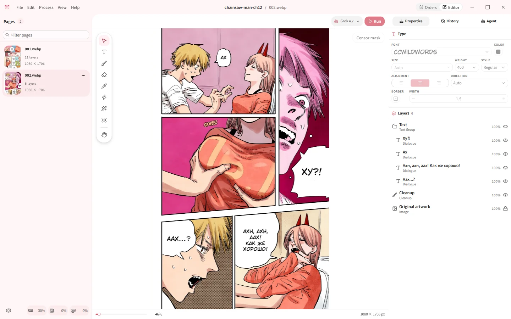

## Cleanup

| Feature | What it does | Docs |
|---|---|---|
| Split lettering routes | Detection writes separate masks for text inside bubbles and for lettering over artwork. Bubbles get a flat fill or LaMa/AOT; artwork gets a generative model. Sound effects that upstream leaves on the page are removed. | [Cleanup evidence](cleanup-evidence.md) |
| More artwork models | Adds a FLUX.2 Klein 9B profile (optional LoRA) and ComfyUI SDXL backends (Animagine XL 4.0, Illustrious XL 2.0) to upstream's LaMa, AOT, FLUX.2 Klein 4B and RORem. Each stage keeps its own prompt and sampling settings for every model. | [Generative integrations](../development/generative-inpainting-integrations.md) |
| Manual repair brushes | Upstream's single inpaint brush becomes three: **Fast** (LaMa/AOT), **Inpainting (FLUX)** with saved presets, and **Decensor**. Strokes queue and run while you keep drawing. | [Cleanup and inpainting](../workflow/cleanup-and-inpainting.md) |
| Censor detection and Decensor | Optional stages: find bars, white strokes and mosaics into a reviewable mask, then reconstruct only that mask. | [Generative integrations](../development/generative-inpainting-integrations.md#automatic-censorship-mask) |

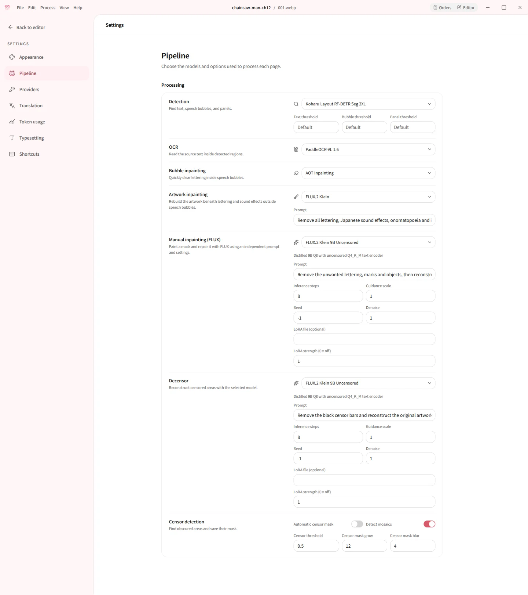

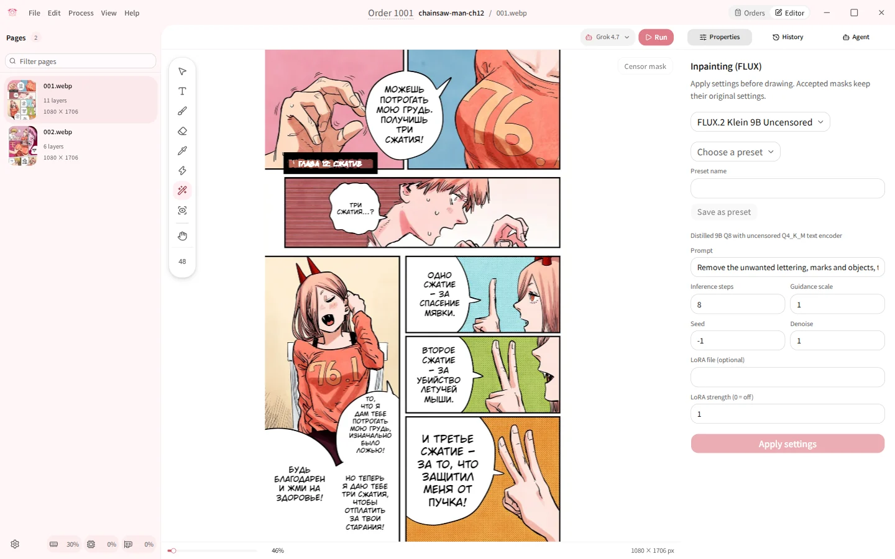

## Translation

| Feature | What it does |
|---|---|
| Content profiles | Manga, Comic and Hentai profiles, each with its own editable system prompt; `{source}` and `{target}` insert the run's languages. |
| Automatic validators | Reject translations that still contain a blocked script (Latin, kana, Han, Hangul presets or custom rules) and retry with feedback. |
| Page-local policy rejections | When a provider refuses one page, the other pages still translate and the refused page numbers are reported. |
| Reasoning effort, transient retries | Per-model reasoning effort; transient provider errors are retried. |
| Cursor provider | Translate through a Cursor cloud agent. |
| Token usage journal | Every model request with its reported tokens and cost, filterable by provider, model, operation and date. Prompts and responses are never stored. |

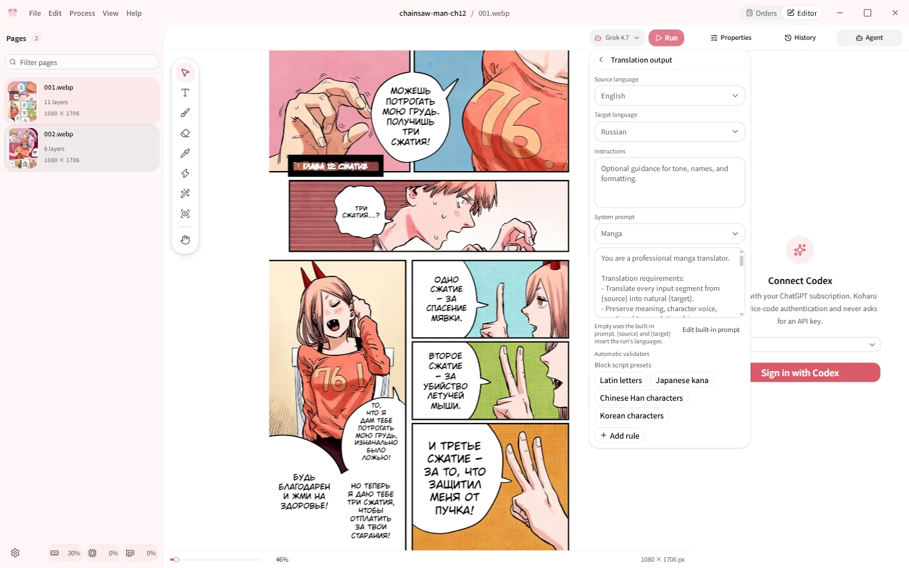

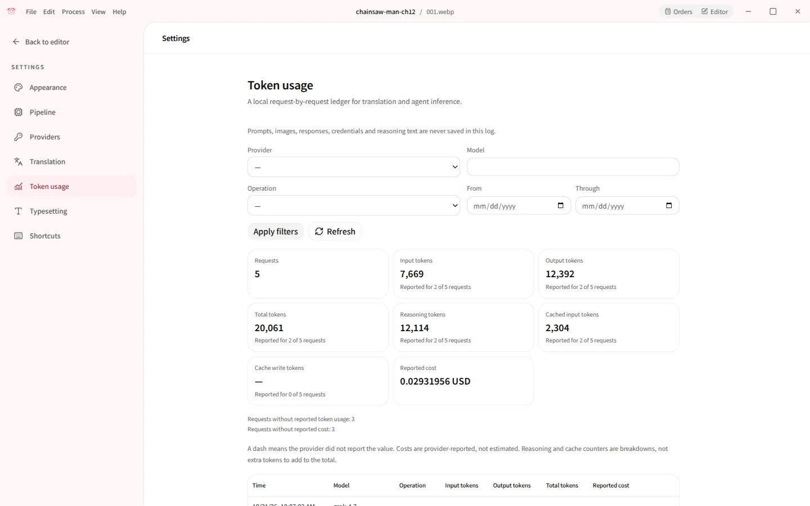

## Editor

| Feature | What it does |
|---|---|
| History panel | Photoshop-style list of named states. Click any state to go back, take named snapshots, clear history. |
| Layer clipboard | Copy and paste text and raster layers between pages; pixels stay in the native process. |
| Pipeline stage picker | Adds Censor detection and Decensor to upstream's Detection, OCR, Translation and Inpainting; run any subset. |
| Resource monitor | Extends upstream's monitor to CPU, RAM, GPU and VRAM in the status bar. |
| Gallery import | Download e-hentai, exhentai and nhentai galleries into one project; exhentai cookies are kept in the system keychain. |

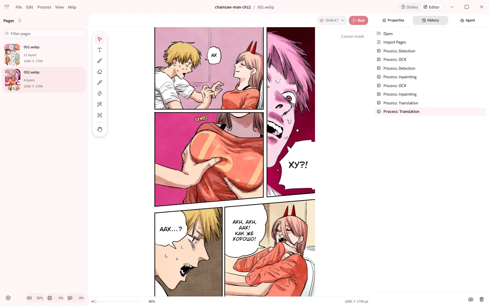

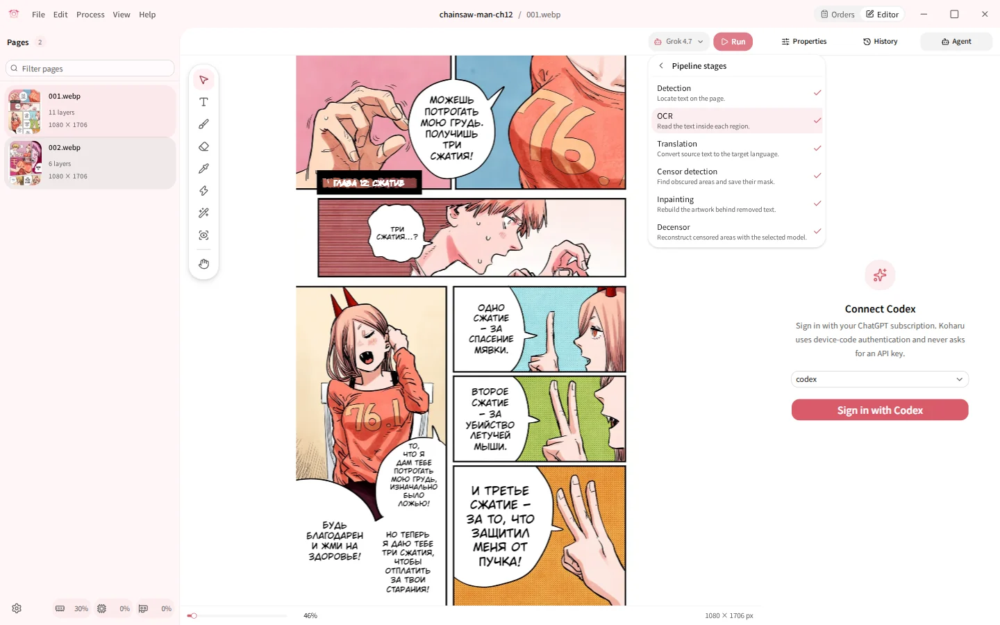

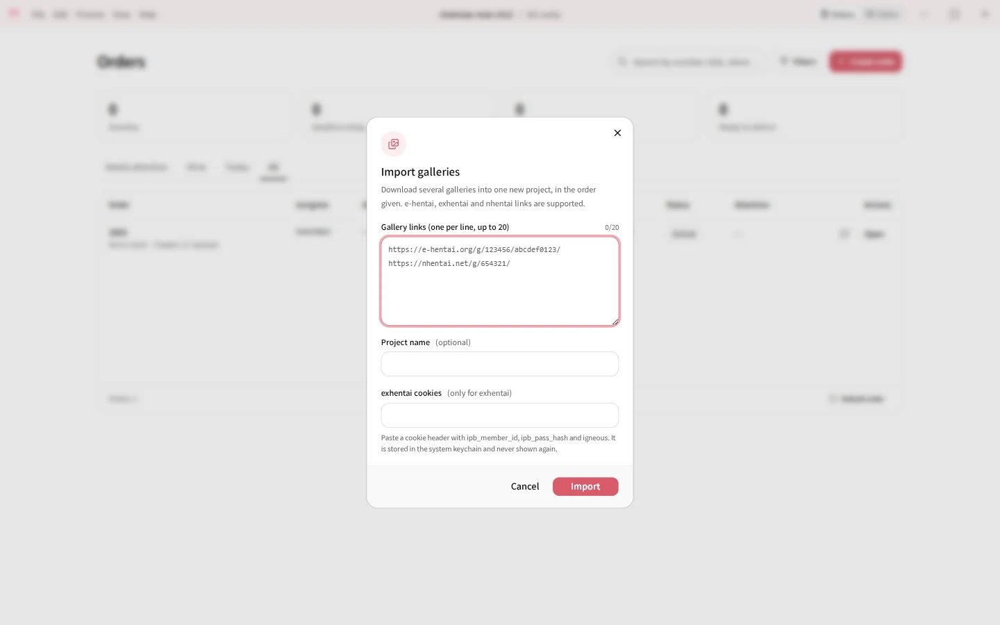

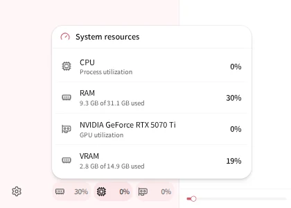

## Agent

Upstream's agent signs in with Codex only. The fork adds a provider choice
with **Grok** and **Kimi Code**; all three use device-code OAuth, so no API key
is pasted into Koharu.

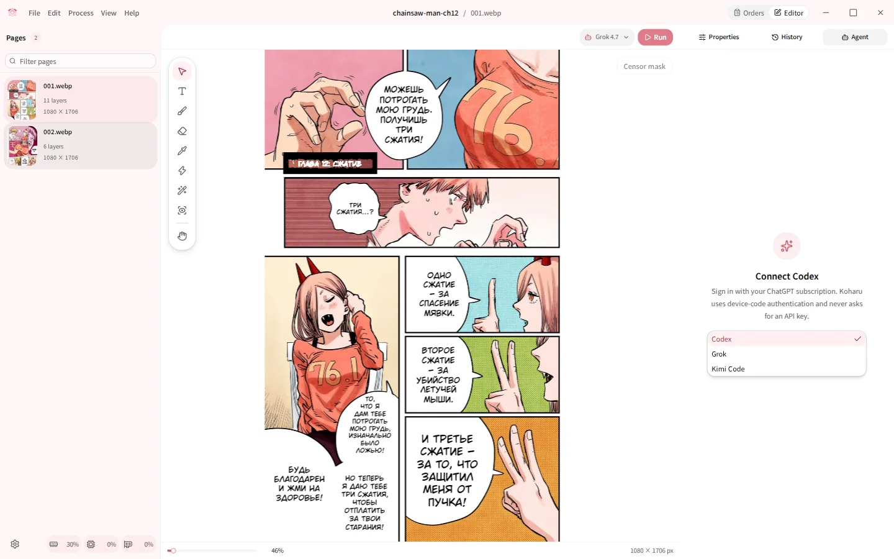

## Production

| Feature | What it does | Docs |
|---|---|---|
| Orders dashboard | Orders, stages, deadlines, notes, an audit log, and an `.xlsx`/`.csv` translation exchange for outside translators. | [Orders dashboard](../workflow/orders.md) |
| Automation API | Loopback HTTP API to create a project, import pages, run the pipeline and export results from another program, such as a chat bot. | [Automation API](../development/automation-api.md) |
| Isolated profiles | `KOHARU_CONFIG_DIR` and `KOHARU_PROJECTS_DIR` move configuration, journals, projects and orders. | [Settings](../reference/settings.md#isolated-profiles) |
| Stage timings | `stage-timings.jsonl` beside `config.toml` records stage, commit and job durations (no page content), for performance work on real runs. | — |

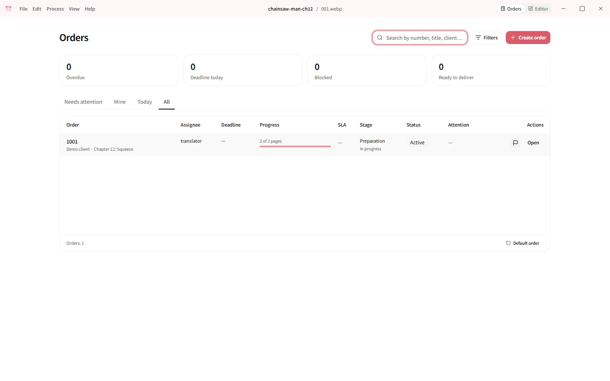

## Differences from upstream packaging

- The upstream auto-updater is removed: it would replace this build with
  upstream releases. Build installers locally (see the README).
- The release bundle includes the Er0mangaSeg censor model, exported with
  `scripts/export_eromangaseg.py`, and its license notices.
- Default models that are downloaded at run time keep their own licenses.
  FLUX.2 Klein 4B is Apache-2.0; FLUX.2 Klein 9B is under the FLUX
  Non-Commercial License and is never the default for text cleanup.
