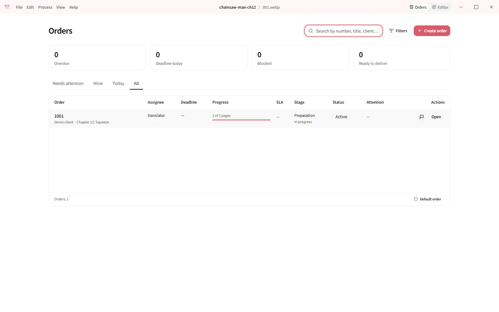
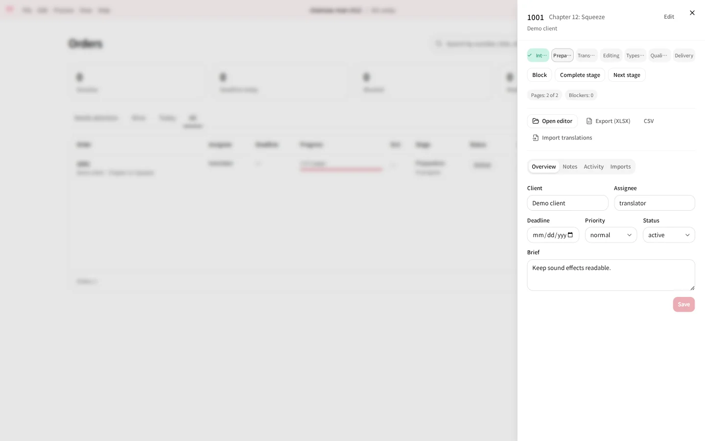

# Orders dashboard

The orders dashboard tracks translation work that arrives from clients: who
ordered what, which production stage each order is in, what is blocked and
what is late. It is a fork feature for studios and teams; a single translator
can leave it off.

Orders are administrative records. Projects stay ordinary editor documents:
an order only points at a project, the dashboard never stores page data, and
undoing an edit in the editor never changes an order.



## Turn it on

The dashboard is hidden by default. Enable it in `config.toml`:

```toml
[ui]
orders = true
```

After a restart the title bar shows two workspaces, **Orders** and **Editor**,
and Koharu opens on Orders.

## What an order holds

| Field | Meaning |
|---|---|
| Number, title, client | How the order is referred to. The number is unique. |
| Languages, assignee, brief | What to deliver and who is responsible. |
| Lifecycle | `active`, `on hold`, `completed`, `delivered` or `cancelled`. |
| Stages | `intake`, `preparation`, `translation`, `editing`, `typesetting`, `QA`, `delivery`, each `not started`, `in progress`, `blocked` or `done`. A blocked stage asks for a reason. |
| Priority and due date | Drive the attention markers and the SLA filter. |
| Page counters | Computed from the linked project: pages, prepared pages (detection and OCR ran) and translated pages. They are never typed in. |
| Notes and activity | Free-form notes, resolvable questions, and an audit log of every change with its local author. |

Opening an order shows a sheet with **Overview**, **Notes**, **Activity** and
**Imports** tabs. **Attach project** links an existing `.khrproj` or creates a
new one; **Open editor** switches to the Editor workspace on that project.



## Translation exchange

Outside translators can work in a spreadsheet instead of the editor.

1. **Export (XLSX)** or **CSV** writes a file with one row per text segment of
   the linked project: `order_number`, `page`, `segment_id`, `source_text`,
   `translation`, `translator_note`, `review_status` (`translated` or
   `needs_review`).
2. The translator fills in `translation` and sends the file back.
3. **Import translations** parses the file into a preview of new, changed and
   unchanged rows plus every problem found: wrong order or page, unknown or
   duplicate `segment_id`, source text changed since the export, missing
   columns, empty translations, unreadable encoding. Nothing touches the
   project yet. The uploaded file is kept as a checksum-addressed attachment;
   uploading the same file again is detected instead of creating a duplicate.
4. Applying the preview writes all accepted rows to the project at once. The
   import is a single History entry and can be undone like any other edit.

Rows are keyed only by `segment_id`. Source lines repeat in manga ("Ah!"), so
text is never used to find a row.

## Where the data lives

The dashboard uses one SQLite file, `orders.sqlite3`, in the project library
(`Documents/Koharu` by default, or `KOHARU_PROJECTS_DIR`). Deleting a project
folder leaves its order intact; the order then shows the project as missing.

## Creating orders from another program

A bot or script can create an order together with its project through the
[automation API](../development/automation-api.md#linking-an-orders-dashboard-entry).
